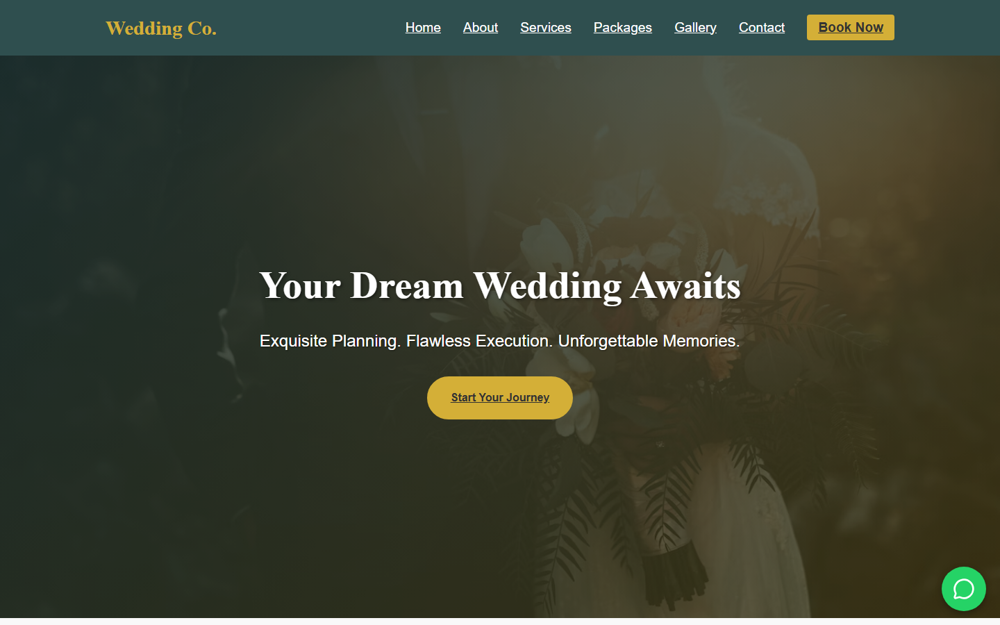
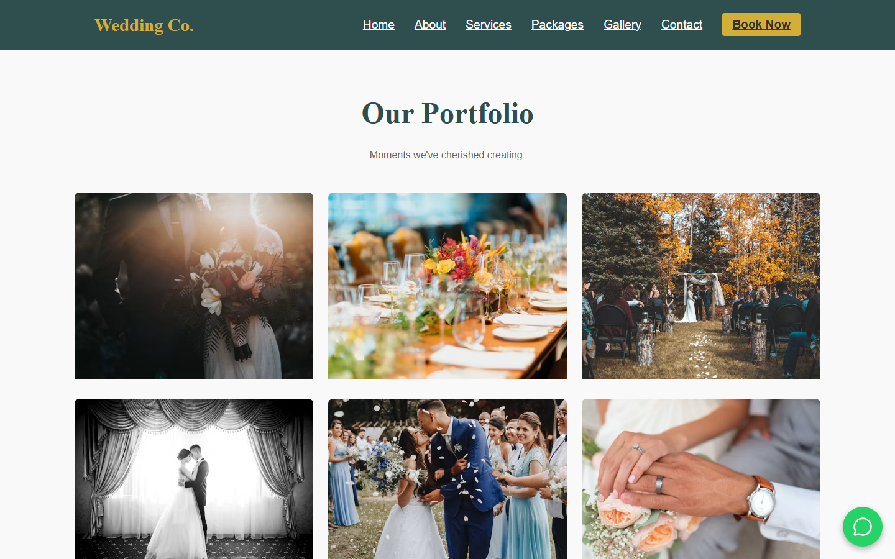
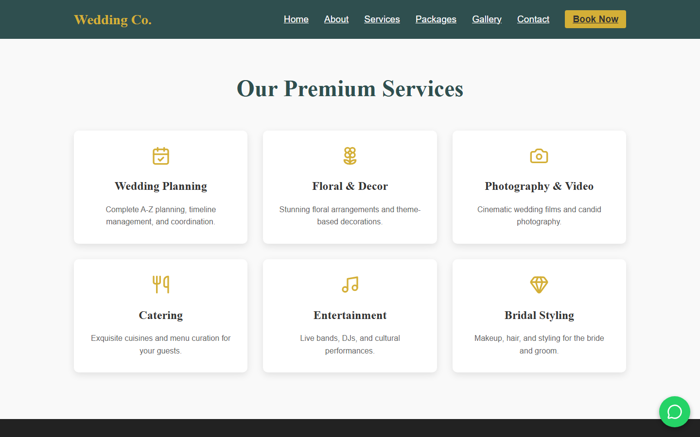
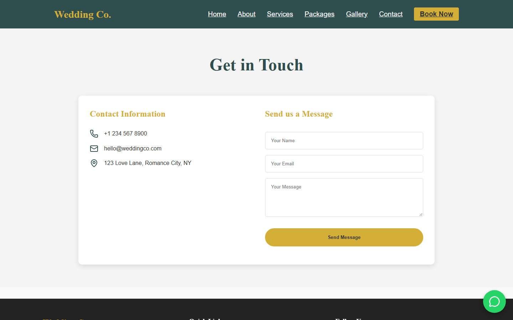

<div align="center">

# 💍 Wedding Company Website

A responsive, elegant, and modern web application for a luxury wedding planning and event management company, built with React 19 and Vite.

[](https://wedding-company-2-49p1.onrender.com/)
[](https://react.dev/)
[](https://vitejs.dev/)
[](https://wedding-company-2-49p1.onrender.com/)

[Live Demo](https://wedding-company-2-49p1.onrender.com/) · [Report Bug](https://github.com/MEHTHAB-N-M/wedding_company/issues) · [Request Feature](https://github.com/MEHTHAB-N-M/wedding_company/issues)

</div>

---

## 📑 Table of Contents

- [Overview](#-overview)
- [Screenshots](#-screenshots)
- [Features](#-features)
- [Tech Stack](#-tech-stack)
- [Project Structure](#-project-structure)
- [Getting Started](#-getting-started)
- [Available Scripts](#-available-scripts)
- [Deployment](#-deployment)
- [Author](#-author)

---

## 📖 Overview

**Wedding Co.** is a complete, full-featured web platform crafted for a luxury wedding planning and event management firm. It presents prospective couples with everything they need to plan their special day: curated service offerings, tiered pricing packages, a high-resolution photo portfolio, trusted vendor directories, client testimonials, an interactive appointment reservation form, and a password-protected administrative overview.

Built with **React 19**, styled using custom gold & slate-gray design tokens, and bundled with **Vite**, the application delivers near-instant page loads and smooth client-side routing.

---

## 📸 Screenshots

| Home | Gallery |
| :---: | :---: |
|  |  |

| Services | Contact |
| :---: | :---: |
|  |  |

---

## ✨ Features

- 📱 **Fully Responsive Design**: Optimized fluid layout across mobile, tablet, laptop, and desktop viewports with a collapsible navigation drawer.
- 💼 **Curated Services Showcase**: Highlights 6 core services (Full Planning, Floral & Decor, Photography & Video, Catering, Entertainment, Bridal Styling) with hover micro-interactions.
- 💎 **Tiered Wedding Packages**: Detailed comparison of Silver, Gold, and Platinum packages with transparent pricing, deliverables, and direct booking links.
- 🖼️ **Interactive Photo Gallery**: Curated visual portfolio of wedding moments featuring image scaling animations.
- 📅 **Online Appointment Booking**: Dedicated consultation reservation form with tentative date picker and service selection.
- 🤝 **Trusted Partner Directory**: Curated vendor list featuring top photographers, florists, caterers, and DJs.
- 💬 **Testimonials & FAQs**: Social proof from couples and answers to frequently asked wedding planning questions.
- 📞 **Direct WhatsApp Integration**: Persistent floating WhatsApp widget for instant, real-time client consultations.
- 🔐 **Protected Admin Dashboard**: Password-authenticated administrative view displaying live metrics (total bookings, pending inquiries, new reviews).
- 🔍 **Dynamic SEO Management**: Per-page document title and meta description injection powered by `react-helmet-async`.
- ⚡ **Optimized Performance**: Production asset hashing, tree-shaking, and fast compilation with Vite.

---

## 🧱 Tech Stack

| Layer | Technology | Details |
| :--- | :--- | :--- |
| **Core Framework** | React 19 (`^19.2.0`), React DOM | Component-driven architecture |
| **Language** | JavaScript (ES6+) | Modern standard syntax |
| **Routing** | React Router DOM v7 (`^7.13.0`) | Client-side SPA routing with 12 configured routes |
| **Styling & Theme** | Vanilla CSS3 | Custom CSS variables (Gold `#D4AF37`, Slate `#2F4F4F`, Misty Rose `#FFE4E1`) |
| **Icons & UI** | Lucide React (`^0.563.0`) | Modern SVG icons |
| **Animations** | Framer Motion (`^12.33.0`) | Smooth transitions and keyframe fade-ins |
| **SEO & Head** | React Helmet Async (`^2.0.5`) | Dynamic per-route `<title>` and `<meta>` tags |
| **Build Tool** | Vite (`^7.2.4`) | High-speed ESM bundler and dev server |
| **Code Quality** | ESLint (`^9.39.1`) | Linting and code consistency rules |
| **Hosting** | Render | Static site hosting via `render.yaml` with SPA rewrite rules |

---

## 📂 Project Structure

```text
wedding_company/
├── docs/
│   └── screenshots/              # Visual previews (home.png, gallery.png, service.png, contact.png)
├── public/                       # Static public assets
├── src/
│   ├── assets/                   # Static media and component assets
│   ├── components/               # Reusable global layout elements
│   │   ├── Footer.jsx            # Multi-column footer with social links & newsletter
│   │   ├── Navbar.jsx            # Sticky navigation header with mobile toggle
│   │   └── WhatsAppWidget.jsx    # Floating WhatsApp quick-contact button
│   ├── pages/                    # 12 distinct application views
│   │   ├── About.jsx             # Company story, values, and milestone stats
│   │   ├── Admin.jsx             # Password-protected admin metrics dashboard
│   │   ├── Booking.jsx           # Online appointment booking form
│   │   ├── Contact.jsx           # Contact information & message inquiry form
│   │   ├── FAQ.jsx               # Frequently asked questions list
│   │   ├── Gallery.jsx           # Portfolio photo gallery
│   │   ├── Home.jsx              # Hero banner, value propositions & highlights
│   │   ├── Packages.jsx          # Silver, Gold, Platinum pricing cards
│   │   ├── Privacy.jsx           # Privacy policy and terms overview
│   │   ├── Services.jsx          # Comprehensive 6-service offerings grid
│   │   ├── Testimonials.jsx      # Client feedback and star reviews
│   │   └── Vendors.jsx           # Directory of trusted vendor partners
│   ├── App.css                   # App container styles
│   ├── App.jsx                   # Central routing definition (`<Routes>`)
│   ├── index.css                 # Global design system, typography & responsive rules
│   └── main.jsx                  # React DOM root entry point
├── eslint.config.js              # ESLint configuration
├── index.html                    # Root HTML document with viewport meta
├── package.json                  # Dependencies, scripts, and overrides
├── render.yaml                   # Render static site blueprint with SPA routing
└── vite.config.js                # Vite configuration with React plugin
```

---

## 🚀 Getting Started

### Prerequisites

- **[Node.js 18+](https://nodejs.org/)**
- **npm** (comes bundled with Node.js)

### Installation

1. **Clone the repository:**
   ```bash
   git clone https://github.com/MEHTHAB-N-M/wedding_company.git
   cd wedding_company
   ```

2. **Install project dependencies:**
   ```bash
   npm install
   ```

3. **Start the local development server:**
   ```bash
   npm run dev
   ```

   Open `http://localhost:5173` in your browser.

---

## 🛠️ Available Scripts

In the project directory, you can run:

| Command | Action / Purpose |
| :--- | :--- |
| `npm run dev` | Starts the Vite development server with Hot Module Replacement (HMR) |
| `npm run build` | Compiles and minifies the app into `dist/` for production |
| `npm run preview` | Locally serves the production build from `dist/` |
| `npm start` | Previews the production build with `--host` enabled for network access |
| `npm run lint` | Analyzes code quality and syntax with ESLint |

---

## ☁️ Deployment

The project is pre-configured for automated deployment on **Render** via the included [`render.yaml`](./render.yaml).

### Deploying to Render

1. Push your repository to **GitHub**.
2. Go to the [Render Dashboard](https://dashboard.render.com/).
3. Choose **New** → **Blueprint** and connect your repository (Render will automatically read `render.yaml`).
   *Alternatively, create a **Static Site** with these settings:*
   - **Build Command:** `npm run build`
   - **Publish Directory:** `dist`
   - **Rewrite Rule:** Source `/*` → Destination `/index.html` (for SPA client-side routing)
4. Trigger the deployment.

🌐 **Live Website:** [https://wedding-company-2-49p1.onrender.com/](https://wedding-company-2-49p1.onrender.com/)

---

## 👨‍💻 Author

**Mehthab N M** — *Full-Stack & Python Developer*

- 🌐 **Portfolio:** [mehthab-n-m.github.io/My_portfolio](https://mehthab-n-m.github.io/My_portfolio/)
- 🐙 **GitHub:** [@MEHTHAB-N-M](https://github.com/MEHTHAB-N-M)
- 💼 **LinkedIn:** [in/mehthab-n-m-637611344](https://www.linkedin.com/in/mehthab-n-m-637611344)

---

<div align="center">

⭐ If you found this project helpful or inspiring, please consider giving it a star!

</div>
